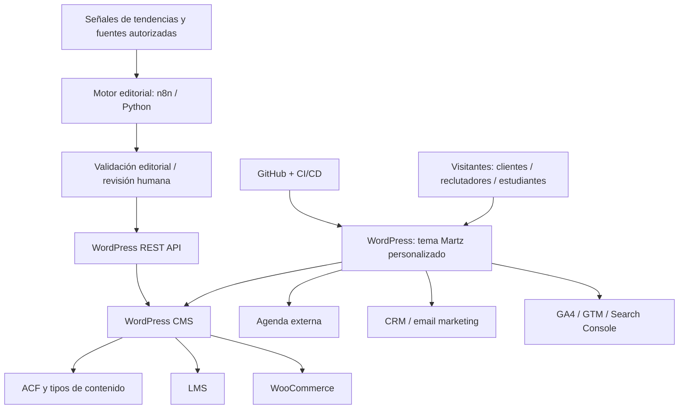

# MartzFavela.com — Arquitectura técnica v1.0

**Estado:** Propuesta inicial para revisión y ejecución por fases  
**Fecha:** 2026-10-24  
**Repositorio:** `marthafavela/martzfavela.com`  
**Responsable del producto:** Martha Favela  
**Documento:** `docs/ARCHITECTURE.md`

## 1. Visión del producto

MartzFavela.com será una plataforma de marca personal y negocio digital orientada a tres audiencias: (1) clientes de consultoría y desarrollo en IA, automatización y Revenue Operations; (2) reclutadores y empresas que evalúan trayectoria, competencias y resultados; y (3) estudiantes interesados en cursos, plantillas y recursos digitales.

**Objetivo:** transformar tráfico relevante en oportunidades comerciales, contactos profesionales e ingresos por educación y productos digitales.

**Principios:** lanzamiento incremental; contenido propio y verificable; diseño distintivo; medición por conversiones; seguridad y privacidad desde el inicio; modularidad y portabilidad.

## 2. Decisiones de arquitectura (ADR)

| ID | Decisión | Justificación | Estado |
|---|---|---|---|
| ADR-001 | Conservar WordPress como CMS y núcleo transaccional | Administración de contenido, usuarios, LMS y tienda sin reconstruir infraestructura | Propuesta |
| ADR-002 | Tema propio desarrollado en VS Code, con Elementor solo de manera selectiva | Mantener identidad visual y control de código/rendimiento | Propuesta |
| ADR-003 | No adoptar WordPress headless en la fase 1 | Reducir complejidad en autenticación, LMS, pagos y renderizado SEO | Propuesta |
| ADR-004 | Automatizaciones como servicios independientes de WordPress | Separar investigación editorial, APIs, colas y publicación | Propuesta |
| ADR-005 | GitHub como fuente de verdad para código y documentación | Historial, revisiones, despliegues y continuidad de desarrollo | Aprobada para el proyecto |
| ADR-006 | Publicaciones generadas con IA sujetas a validación | Evitar errores, duplicados y contenido de poco valor | Propuesta |

## 3. Audiencias, journeys y conversiones

| Segmento | Necesidad | Secciones prioritarias | Conversión |
|---|---|---|---|
| Clientes | Validar experiencia y resolver un problema de negocio | Servicios, casos, agenda, contacto | Lead calificado / sesión agendada |
| Reclutadores | Evaluar resultados, liderazgo y capacidades técnicas | Sobre mí, portafolio, CV, GitHub, LinkedIn | Contacto / entrevista |
| Estudiantes | Aprender y adquirir herramientas | Academia, recursos, blog, tutoriales | Registro, inscripción, compra |

Cada ruta debe contar con CTA, fuente de adquisición y eventos de conversión definidos.

## 4. Arquitectura lógica



La agenda, LMS, CRM y pasarela de pagos se seleccionarán después de validar costos, compatibilidad, privacidad y operaciones en México. No asumir que las redes sociales permiten extracción o publicación automática sin permisos.

## 5. Stack propuesto

| Capa | Solución inicial | Consideraciones |
|---|---|---|
| CMS | WordPress existente | Confirmar versión, PHP, backups, acceso a hosting |
| Frontend | Tema `martz-custom` PHP + CSS + JS | Optimizar Web Vitals, accesibilidad, animaciones con `prefers-reduced-motion` |
| Maquetación | Elementor Pro, uso restringido | Evitar dependencia para componentes estratégicos |
| Datos estructurados propios | ACF + CPT en plugin `martz-core` | Tipos de contenido independientes del tema |
| E-commerce | WooCommerce | Productos virtuales/descargables; impuestos, pagos y facturación sujetos a validación |
| LMS | LearnDash **o** alternativa evaluada | Verificar licencias, idioma, cobros, progreso y roles |
| Citas | Calendly **o** alternativa | Zonas horarias, buffers, formularios y avisos |
| SEO | Yoast **o** Rank Math | Elegir solo uno; sitemap, canonicals y metadatos |
| Idiomas | Polylang **o** WPML | Español principal; inglés y francés por fases |
| Automatización | n8n + Python | Logs, aprobaciones, reintentos, límites por API |
| Analítica | GA4 + GTM + Search Console | Consentimiento, conversiones y UTMs |
| Código | VS Code, Git, GitHub; Codex posteriormente | Branches, PRs, CI y revisiones |

**No contratar todos los plugins en fase 1.** Primero se realiza una auditoría técnica y se establece presupuesto.

## 6. Mapa del sitio y rutas sugeridas

- `/` — storytelling, propuesta de valor y rutas por audiencia.
- `/services/` — IA, automatización, RevOps y desarrollo.
- `/about/` — trayectoria, habilidades y enlaces profesionales.
- `/projects/` — índice del portafolio.
- `/projects/{slug}/` — caso detallado con contexto, rol, stack, proceso y resultados verificables.
- `/insights/` y `/insights/{slug}/` — contenidos editoriales.
- `/academy/` y `/academy/{slug}/` — catálogo y ficha de curso.
- `/resources/` — recursos digitales.
- `/book/` — reserva de consultoría.
- `/contact/` — contacto con consentimiento.
- `/privacy/` y páginas legales aplicables.

**Internacionalización:** escoger una única arquitectura de URL (por ejemplo `/en/` y `/fr/` para traducciones), `hreflang`, canonicals correctos y traducciones revisadas; evitar mezclar estrategias.

## 7. Modelo de datos WordPress

Se recomienda mantener los siguientes **Custom Post Types**, o su equivalente compatible con los plugins seleccionados:

### `project`

- `title`, `slug`, `summary`, `hero_image`, `date`, `status`
- `industry`, `skills`, `technologies`, `role`, `team_size` (opcional)
- `challenge`, `approach`, `architecture`, `deliverables`, `outcomes`
- `metrics` (solo si se pueden acreditar), `screenshots`, `external_links`
- `publication_permission`, `confidentiality_notes`, `featured`

### `service`

- `title`, `audience`, `business_problem`, `deliverables`
- `engagement_model`, `faq`, `cta`, `related_projects`

### `resource` / productos

- Preferir entidades de WooCommerce para precio, inventario lógico, pedidos, acceso y descargas.
- Campos extra: formato, nivel, versión, changelog, licencia de uso y producto relacionado.

### `course`

- Usar el tipo de contenido del LMS elegido, sin duplicar alumnos, inscripciones y progreso en CPT personalizados.

### Blog

- Usar los posts nativos; taxonomías temáticas: IA aplicada, RevOps, desarrollo y aprendizaje.
- Metadatos de operación editorial: origen de la idea, referencias, responsable de revisión, fecha de verificación, público, etapa de funnel, CTA y fecha de actualización.

## 8. Motor editorial de tendencias (Martz Content Intelligence Engine)

### Pipeline

1. **Recolección:** Search Console (datos propios), Google Trends en modalidad de acceso habilitada, feeds autorizados, YouTube Data API, newsletters y otras APIs permitidas.
2. **Normalización:** fecha/hora, fuente, tema, enlaces originales, país, idioma, tendencias y deduplicación.
3. **Clustering:** agrupar palabras clave, preguntas e intención de búsqueda; detectar canibalización frente a artículos existentes.
4. **Puntuación:** relevancia comercial (30%), intención (25%), demanda (20%), oportunidad SEO/GEO (15%) y experiencia propia disponible (10%). Los pesos son hipótesis a validar.
5. **Brief:** pregunta principal, audiencia, intención, ángulo original, estructura, fuentes, CTA y enlaces internos propuestos.
6. **Investigación y borrador asistido por IA:** no presentar información sin fuentes verificables ni inventar métricas o experiencia propia.
7. **Quality gate:** verificación factual, derechos de autor, valor original, estilo editorial, revisión humana, enlaces, accesibilidad y metadatos.
8. **Publicación:** iniciar como borrador mediante WordPress REST API; programar solo contenidos aprobados.
9. **Distribución:** generar piezas específicas para cada canal sujeto a sus APIs, políticas y autorizaciones.
10. **Medición:** impresiones, clics, posiciones, conversiones asistidas, leads, ventas y rendimiento por categoría.

**Cadencia inicial:** investigación todos los días; 3 publicaciones revisadas por semana. Ampliar según calidad y resultados, nunca solo por volumen.

### Entidades lógicas del motor

`trend_signal`, `topic_cluster`, `content_opportunity`, `editorial_brief`, `article_draft`, `approval`, `publication`, `performance_snapshot`, `automation_run`.

### Controles operativos

- Idempotencia: el mismo brief no debe publicar dos veces.
- Registro de fuentes, fecha de consulta, prompt/modelo (si aplica) y versión del artículo.
- Límites por proveedor, backoff y reintentos.
- Revisión obligatoria para información sensible, afirmaciones técnicas, precios o datos recientes.
- Posibilidad de pausar el sistema sin afectar WordPress.
- Las credenciales nunca se almacenan en el repositorio.

## 9. SEO, GEO y distribución

- Arquitectura de información por intención y audiencia; clusters y enlaces internos a casos, servicios, cursos y recursos.
- SEO técnico: indexabilidad, sitemap XML, canonical, robots, performance, seguridad HTTPS, imágenes optimizadas, semántica y accesibilidad.
- Marcado Schema.org válido cuando corresponda: `Person`, `ProfilePage`, `Article`, `BreadcrumbList`, `Course`, `Product`, sin inventar reseñas ni calificaciones.
- Autoría reconocible y experiencias originales documentadas, especialmente en el portafolio.
- Para sistemas de búsqueda asistidos por IA, priorizar contenido indexable, verificable, con citas claras, respuestas directas y consistencia de entidad; no prometer inclusión en respuestas.
- Eventos de analítica: `lead_submit`, `booking_start`, `booking_confirmed`, `cv_download`, `project_view`, `resource_purchase`, `course_enroll` (nomenclatura definitiva durante implementación).
- UTMs normalizados para Meta, TikTok, LinkedIn, Google Ads, YouTube y email.

## 10. Privacidad, seguridad y operaciones

- Separar desarrollo, staging y producción; respaldos probados antes de cambios críticos.
- `main` protegida; ramas por feature y PRs cuando comience el desarrollo colaborativo.
- 2FA en GitHub y WordPress, roles mínimos, actualizaciones y plugins auditados.
- Variables secretas en gestores de secretos o variables del servidor, **nunca en archivos comiteados**.
- WordPress Application Passwords con privilegios mínimos para integraciones REST y solo mediante HTTPS.
- Consentimiento y avisos adecuados para formularios, analítica, marketing y alumnos; validar obligaciones legales aplicables en México.
- Cifrado en tránsito; resguardo apropiado de datos, sesiones, pedidos y descargas.
- Para productos digitales: protección de archivos, caducidad/permisos de descarga, políticas de soporte y devoluciones.
- Observabilidad: errores PHP, fallas de integraciones, webhooks, colas, estado de respaldo y uptime.
- Prohibido sincronizar al repositorio base de datos de producción, archivos de usuarios y `wp-content/uploads` con datos privados.

## 11. Estructura del repositorio (objetivo)

```text
martzfavela.com/
├── README.md
├── .gitignore
├── docs/
│   ├── ARCHITECTURE.md
│   ├── ADR/
│   ├── CONTENT_STRATEGY.md           # futura
│   ├── DATA_MODEL.md                 # futura
│   └── DEPLOYMENT.md                 # futura
├── wordpress/
│   ├── themes/
│   │   └── martz-custom/
│   └── plugins/
│       └── martz-core/
├── automation/
│   ├── trend-research/
│   ├── editorial-engine/
│   └── publishing/
├── integrations/
│   ├── crm/
│   ├── scheduling/
│   └── analytics/
├── tests/
└── .github/
    └── workflows/
```

Estos directorios de implementación se crearán cuando se inicie el módulo correspondiente; no es necesario crear carpetas vacías hoy.

## 12. Hoja de ruta y backlog inicial

### Fase 0 — Fundaciones
- [ ] Clonar repositorio y subir `ARCHITECTURE.md`, `README.md`, `.gitignore`.
- [ ] Inventariar hosting, dominio, WordPress, plugins, licencias, PHP y backups.
- [ ] Registrar infraestructura y acceso de staging (sin contraseñas).
- [ ] Acordar diseño aprobado y criterios de aceptación de la landing actual.
- [ ] Definir analítica, eventos, consentimientos y KPIs basales.

### Fase 1 — Sitio de captación
- [ ] Crear tema hijo o tema propio según auditoría; decidir entre las dos opciones formalmente.
- [ ] Landing multidioma (ES, EN, FR) y navegación responsive.
- [ ] Páginas de servicios, trayectoria, CV y contacto.
- [ ] CPT de proyectos, taxonomías y plantillas de casos de éxito.
- [ ] Integrar agenda con calificación de leads y medición de reservas.
- [ ] Performance, accesibilidad, seguridad y SEO técnico.

### Fase 2 — Autoridad y contenido
- [ ] Arquitectura de taxonomías y clusters editoriales.
- [ ] Integrar Search Console y fuentes autorizadas.
- [ ] Motor de oportunidades + drafts, QA y aprobación humana.
- [ ] Social repurposing y dashboards.

### Fase 3 — Academia y productos
- [ ] Evaluar LMS por costos, experiencia del alumno e integración.
- [ ] Integrar WooCommerce y pasarela de pago.
- [ ] Cursos, recursos digitales, emails transaccionales y métricas.

### Fase 4 — Optimización
- [ ] CRM/scoring comercial y atribución.
- [ ] Experimentos de conversión y optimización continua.
- [ ] Extender multidioma a contenido estratégico y cursos priorizados.

## 13. Criterios de aceptación para el MVP

- Un cliente puede identificar un servicio y enviar un lead o agendar una cita correctamente.
- Un reclutador puede consultar al menos tres casos de estudio completos y acceder al CV / LinkedIn.
- El sitio funciona correctamente en móvil, tablet y escritorio y con navegación de teclado.
- La medición registra fuentes y eventos clave con consentimiento cuando corresponda.
- Páginas indexables con metadatos, sitemap y URLs correctas; sin errores técnicos críticos.
- El equipo puede editar entradas y proyectos sin modificar código.
- Existe backup restaurable y un procedimiento documentado de despliegue/reversión.

## 14. Riesgos y cuestiones pendientes

| Riesgo o decisión pendiente | Acción previa |
|---|---|
| Compatibilidad de WordPress actual, PHP, hosting y Elementor | Auditoría de instalación |
| Complejidad/costo de LMS + WooCommerce | Matriz de evaluación y prueba en staging |
| Publicación excesiva de contenido genérico | QA y supervisión editorial, resultados antes de escalar |
| APIs externas y permisos de redes | Verificar acceso, costos, límites y términos |
| Multidioma en productos/LMS | Prueba end-to-end antes de comprar licencias |
| Casos confidenciales del historial profesional | Anonimizar, obtener autorizaciones y usar solo métricas publicables |
| Despliegues que modifiquen producción | CI/CD con staging, backup y rollback |

## 15. Próximos documentos

- `docs/DATA_MODEL.md`: ACF, taxonomías, relaciones y esquemas.
- `docs/CONTENT_STRATEGY.md`: pilares, calendario y metodología de temas.
- `docs/DEPLOYMENT.md`: ambientes, backups, CI/CD y rollback.
- `docs/EDITORIAL_ENGINE.md`: flujos, integraciones, prompts, QA, métricas y costos.
- `docs/UX_REQUIREMENTS.md`: pantallas, journey, accesibilidad y componentes.

---

**Nota:** Este es un documento de arquitectura de solución, no una auditoría de la infraestructura actual ni una garantía de posicionamiento SEO/GEO. Las selecciones comerciales y requisitos legales requieren validación antes de su implementación.
